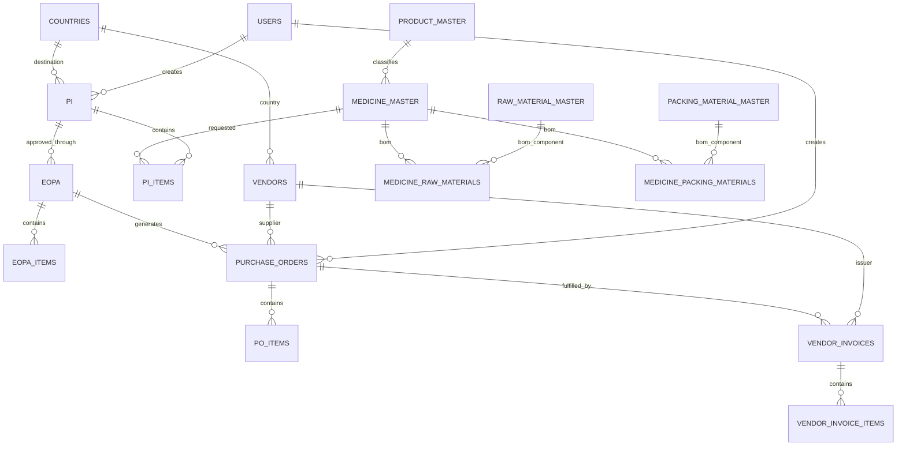

# Pharma procurement schema abstraction for Medusa

## Purpose and scope

This document describes the PostgreSQL schema represented by the current backend SQLAlchemy models and explains how to adapt its concepts for a Medusa ecommerce backend. It is an integration design reference, not a migration script or a claim that the existing database is already Medusa-compatible.

The current application is a pharma procurement, manufacturing, and order-fulfilment system. Medusa is an ecommerce commerce engine. Their concepts overlap in catalog, inventory, counterparties, and order lines, but their workflows differ substantially. Keep the pharma operational records in a dedicated domain module/schema and integrate them with Medusa through stable identifiers and explicit workflows.

## Source and verification notes

- Primary application schema source: `backend/app/models/*.py`.
- The application connection is configured through `DATABASE_URL`; this file does not depend on a live database connection.
- Alembic migrations and `backend/database/pharma_schema.sql` may not match the current models exactly. Verify the deployed database with Alembic history and an actual schema introspection before applying DDL or migrating data.
- Table names below are the SQLAlchemy model `__tablename__` values. Columns are summarized by business role rather than exhaustively enumerated.
- SQLAlchemy uses integer primary keys in these models. Medusa entities commonly use string IDs; do not assume the IDs are interchangeable.

## Domain overview



The main business flow is:

1. A `PI` (proforma invoice) represents a partner/customer-facing request for medicines and quantities.
2. `EOPA` and `eopa_items` hold an estimate and approval checkpoint for that request.
3. `purchase_orders` / `po_items` procure finished goods, raw materials, or packing materials.
4. `vendor_invoices` / `vendor_invoice_items` record what the supplier actually shipped, prices, taxes, and (for medicines) batch/expiry details.
5. `medicine_raw_materials` and `medicine_packing_materials` describe manufacturing bill-of-materials links used for procurement planning.

## Table groups

### Catalog and country reference

| Table | Meaning | Important relationships and attributes |
|---|---|---|
| `product_master` | General product classification | Unique `product_code`, name, description, unit, HSN code, active flag. One-to-many to medicines. |
| `medicine_master` | Sellable/manufactured pharma medicine definition | Unique `medicine_code`, name, `product_id`, composition, dosage form, strength, pack size, units/conversion, packaging, regulatory JSON, vendor assignments. |
| `raw_material_master` | Procurement catalog for ingredients and other raw inputs | Unique `rm_code`, category, UOM, purity, HSN/GST, default supplier, CAS number, storage and shelf-life details. |
| `packing_material_master` | Procurement catalog for packaging inputs | Unique `pm_code`, type, UOM, artwork and physical specs, HSN/GST, default supplier. |
| `countries` | Country/language/currency reference | Unique ISO alpha-3 `country_code`, country name, language, currency, active flag. Referenced by vendors and PIs. |

### Partners, users, and settings

| Table | Meaning | Important relationships and attributes |
|---|---|---|
| `vendors` | Shared counterparty master for partners, suppliers, and manufacturers | Unique `vendor_code`; `vendor_type` is `PARTNER`, `RM`, `PM`, or `MANUFACTURER`; country, contacts, address, GST and compliance/credit fields. A single table currently serves multiple business roles. |
| `users` | Internal application users | Unique username and email, password hash, full name, role (`ADMIN`, `PROCUREMENT_OFFICER`, `WAREHOUSE_MANAGER`, `ACCOUNTANT`), active flag. Not a storefront customer table. |
| `system_configuration` | Application configuration key/value storage | Unique config key, JSON value, category, sensitive flag, update time. Treat sensitive values as secrets and review access policy before migration. |

### Sales request and approval workflow

| Table | Meaning | Important relationships and attributes |
|---|---|---|
| `pi` | Proforma invoice / partner request header | Unique `pi_number`, date, country, partner vendor, total, currency, status, remarks, creator/approver. |
| `pi_items` | Requested medicine lines | Parent PI, medicine, quantity, unit/total price, HSN and pack-size snapshots. |
| `eopa` | Estimated Order & Price Approval header | Unique `eopa_number`, date, PI, status (`PENDING`, `APPROVED`, `REJECTED`), approver and creator. Described by the model as one EOPA per PI. |
| `eopa_items` | Estimated/approved lines | EOPA, source PI item, quantity and estimated price/total. |
| `partner_vendor_medicines` | Which medicines a partner may access | Partner vendor and medicine references, notes, timestamps. Model comment describes one medicine per partner, but no explicit unique constraint is defined in the shown model. |

### Procurement, supplier invoices, and receipt

| Table | Meaning | Important relationships and attributes |
|---|---|---|
| `purchase_orders` | Procurement order header | Unique `po_number`, type (`RM`, `PM`, `FG`), source EOPA, supplier, ship-to manufacturer/address, status and approval lifecycle, delivery/commercial fields, amendment chain and creator. |
| `po_items` | Procurement order lines | Parent PO; nullable references to medicine, raw material, or packing material; ordered/fulfilled quantities, UOM, commercial/tax values, quality, packaging/artwork and delivery specifications. The nullable polymorphic item references have no single product FK; validate exactly one item target in application logic or add a constrained item model. |
| `po_terms_conditions` | Terms copied/customized for a specific PO | PO, text, display priority; PO deletion cascades per model FK. |
| `vendor_invoices` | Supplier invoice / fulfillment document | Unique invoice number, date/type, PO, supplier, totals, currency/exchange rate, status, receiving/processing metadata, optional dispatch and warehouse details. |
| `vendor_invoice_items` | Actual invoice lines and batch details | Invoice; nullable medicine/raw-material/packing-material reference, shipped quantity, actual prices, tax/GST/HSN, optional batch number, manufacturing date and expiry date. |
| `material_receipts` | Receipt records linked to a PO | Receipt number/date, PO, medicine, quantity, batch, receiving user. Model currently only references a medicine, not RM/PM. |
| `dispatch_advice` | Dispatch of finished goods to a destination | Dispatch number/date, medicine, quantity, destination and dispatching user. |
| `warehouse_grn` | Warehouse receipt against dispatch advice | GRN number/date, dispatch advice, quantity and receiving user. |
| `material_balance` | Legacy/derived balance per material, PO and invoice | Raw/packing material, supplier, PO, invoice and ordered/received/balance quantities. A migration named `drop_material_balance_table.py` exists, so confirm whether this table exists in the deployed DB before using it. |

### Manufacturing BOM and supplier terms

| Table | Meaning | Important relationships and attributes |
|---|---|---|
| `medicine_raw_materials` | Medicine-to-raw-material BOM | Medicine, raw material, optional supplier override, quantity per medicine unit/UOM, purity/tax overrides, role, criticality, lead time and wastage. |
| `medicine_packing_materials` | Medicine-to-packaging BOM | Medicine, packing material, optional supplier override, quantity/UOM, artwork overrides, tax, role, criticality, lead time and wastage. |
| `terms_conditions_master` | Reusable terms library | Term text, category, priority, active flag. |
| `vendor_terms_conditions` | Terms assigned to suppliers | Vendor, master term, optional priority override and notes. |

## Relationship and data integrity notes

- The models primarily use integer PKs and ordinary foreign keys. Many FKs omit explicit `ON DELETE` behavior; do not infer cascade deletion from ORM relationships alone.
- `purchase_orders` has several vendor roles: `vendor_id` (supplier) and `ship_to_manufacturer_id` (destination manufacturer). They must not be conflated during Medusa integration.
- `po_items` and `vendor_invoice_items` each have three nullable product-reference columns. The intended type is conveyed by PO/invoice type, but the database model shown does not enforce exactly one populated reference.
- `medicine_master` contains vendor assignments for manufacturer, RM supplier, and PM supplier. BOM rows can override the raw/packing catalog default supplier.
- Prices and quantities use `Numeric`; preserve decimal precision. Currency is present on PIs, POs, and invoices with different field names. Normalize currency handling at integration boundaries.
- Invoice item batch number, manufacturing date, and expiry date are pharma traceability data. They should not be discarded when syncing inventory to an ecommerce system.
- Some model comments describe uniqueness not expressed as a database constraint (notably partner-to-medicine mapping). Audit the actual DDL before relying on those assumptions.

## Medusa concept mapping

Use Medusa's product/catalog and sales channels for customer-facing commerce. Keep procurement, regulatory, manufacturing, and supplier workflow data in a custom Medusa module or a companion service. Link the two domains by external IDs rather than replacing the current schema wholesale.

| Current domain concept | Medusa alignment | Recommended treatment |
|---|---|---|
| `product_master` + `medicine_master` | Product, Product Variant, Product Category, Product Type, Product Tags, custom product/variant metadata | Usually map each medicine SKU to a Medusa product variant. Put dosage/strength/pack size in options/variant attributes where customers select them; keep composition/regulatory data in validated custom fields/module data. `product_master` may become category/type metadata rather than a separate sellable product. |
| `medicine_code` | Variant SKU / external code | Preserve as the stable SKU or store as an external reference. Check uniqueness and existing Medusa SKU conflicts first. |
| `vendors` with `PARTNER` type | Customer, possibly Company/organization extension | A partner/vendor is not automatically a Medusa customer. Decide whether partners place orders as customers, supply products, or both. Map customer accounts separately from supplier records. |
| `vendors` with `RM`, `PM`, `MANUFACTURER` types | Supplier/vendor domain | Keep in custom supplier module or external procurement service. These types do not map to the Medusa customer entity. |
| `users` | Medusa admin users | Do not copy password hashes blindly. Use Medusa's supported identity/account provisioning and role/permission model. Preserve source user IDs for audit attribution. |
| `pi` + `pi_items` | Cart, draft order, or order depending on lifecycle | Treat PI as a quote/request workflow. Map to a Medusa draft order or quote extension if it is not yet a committed order; create a regular order only at the business event that commits the sale. |
| `eopa` + `eopa_items` | Custom approval/quote workflow | Implement as a custom module/workflow linked to Medusa draft order/quote and preserve approval transitions/audit trail. |
| `purchase_orders` + `po_items` | No direct standard storefront-order equivalent | Keep as procurement records in a custom module/service. Medusa customer orders are outbound sales; these POs are inbound supplier procurement. |
| `vendor_invoices` / items | Supplier invoice and receiving extension | Keep in procurement/accounting module. Do not map supplier invoices to Medusa customer payment records. |
| `material_receipts`, `dispatch_advice`, `warehouse_grn` | Inventory levels and inventory adjustments, with lot tracking extension | Sync available stock into Medusa inventory at a chosen location. Preserve receipts, movements, lot/batch, expiry, and audit records in a pharma inventory module. |
| RM/PM BOM tables | Custom manufacturing/BOM module | Retain as manufacturing domain data. They are not ecommerce product variants or Medusa product bundles unless a separate customer-facing kit is intentionally sold. |
| HSN/GST/currency fields | Product tax metadata and region/pricing/tax configuration | Map only after reviewing Medusa tax regions and tax-provider behavior. Keep invoice snapshots and jurisdiction-specific audit values in the source transaction records. |
| `system_configuration` | Medusa config/secrets and custom settings | Move secrets to environment/secret storage. Keep non-secret business settings in a controlled custom settings module if needed. |

Medusa is versioned and its module APIs can change. Confirm the exact target Medusa major version and available modules before implementing this mapping. Use official Medusa module extension points and migrations; avoid writing directly into Medusa-owned tables.

## Suggested target boundary

```text
Medusa-owned domain
  catalog, variants/SKUs, regions, sales channels, carts, customer orders,
  customer identity, payment and customer-facing inventory availability

Custom pharma/procurement domain
  suppliers, raw/packing materials, BOM, PI/EOPA approvals, purchase orders,
  supplier invoices, batch/expiry traceability, GRN/dispatch, regulatory data

Integration links
  Medusa product/variant ID <-> medicine_code / medicine_master.id
  Medusa customer ID <-> partner account reference (when applicable)
  Medusa order ID <-> PI / commercial order reference
  Medusa inventory item + location <-> pharma stock and lot records
```

Prefer explicit mapping tables or custom module relations for these links. Avoid assuming that legacy integer IDs can serve as Medusa IDs. Store source system, source ID, and synchronization timestamps; make sync operations idempotent.

## Migration and implementation checklist

1. Confirm the target Medusa version and whether this app will be embedded as a Medusa module or integrated as a separate service.
2. Introspect the actual PostgreSQL database and reconcile it with SQLAlchemy models and Alembic migrations. Record schema version and extensions.
3. Decide which medicines are customer-visible and define SKU, variant-option, region, sales-channel, and pricing rules.
4. Decide whether PIs represent quotes, draft orders, or committed orders. Define the exact approval-to-order transition.
5. Define partner identity separately from supplier identity; determine if a party may hold both roles.
6. Define inventory ownership and synchronization semantics, including location, reservations, lot/batch, expiry, and unit conversions.
7. Preserve invoice and regulatory snapshots for audit; do not calculate historical values from mutable catalog fields.
8. Add and validate uniqueness/check constraints for polymorphic item references and partner-medicine assignments.
9. Plan ID mapping, backfill, idempotent sync, failure recovery, and reconciliation reports before enabling writes.
10. Test migration on a sanitized copy and verify row counts, foreign keys, quantity totals, currency totals, and lot/expiry traceability.

## Glossary

- **PI**: Proforma invoice; here it acts as a partner medicine request/commercial document.
- **EOPA**: Estimated Order & Price Approval; approval stage between PI and supplier procurement.
- **PO**: Purchase order issued to a supplier; this schema distinguishes raw material (`RM`), packing material (`PM`), and finished goods (`FG`).
- **BOM**: Bill of materials, represented by medicine-to-raw-material and medicine-to-packing-material mapping tables.
- **GRN**: Goods Receipt Note for warehouse receipt.
- **HSN/GST**: Tax classification and rate fields used in the source application's invoicing/procurement data.
